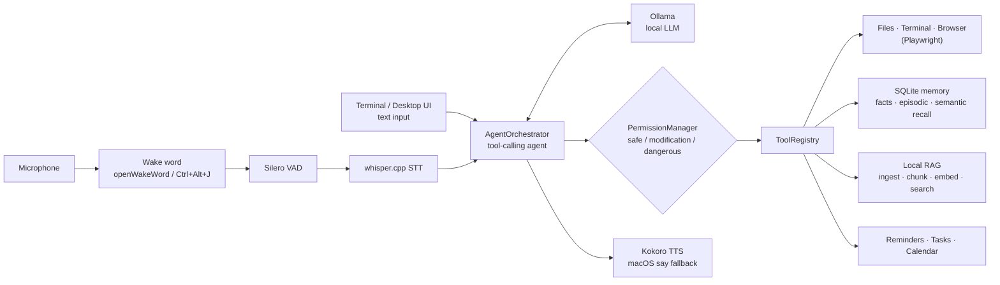

# JARVIS

Local-first personal AI assistant for macOS (Apple Silicon).

**Cost:** $0/month for core operation. Uses local [Ollama](https://ollama.com) — no OpenAI, Anthropic, or other paid APIs required.

## Architecture



Everything runs on the Mac. Voice input passes through wake word, VAD and whisper.cpp before reaching the same agent the text shells use. The agent plans tool calls with a local Ollama model, and every call goes through `PermissionManager` before a tool runs. Replies are spoken with Kokoro, or macOS `say` as a fallback.

## Phase 1 — Text

Terminal assistant with streaming Ollama chat, tools, permissions, SQLite history.

## Phase 2 — Voice

Microphone → Silero VAD → whisper.cpp STT → agent → Kokoro TTS (macOS `say` fallback).

## Phase 3 — Wake word

- Say **“Hey Jarvis”** (openWakeWord ONNX, local)
- Or press **Ctrl+Alt+J** (needs macOS Accessibility permission)
- Or type / press Enter (push-to-talk)

Stock openWakeWord models are **CC BY-NC-SA 4.0** (fine for personal use).

## Phase 4 — Memory

Long-term facts + episodic log in SQLite, with semantic recall (Ollama `nomic-embed-text`, hashing fallback).

```text
You: Remember my test project is Atlas
Jarvis: (stores fact) Got it — I’ll remember that.
# restart JARVIS / new chat session
You: What is my test project called?
Jarvis: Atlas.
```

Tools: `remember_fact`, `recall_memory`, `forget_fact`, `list_memories`.

```bash
ollama pull nomic-embed-text   # optional but recommended for better recall
bash scripts/verify_phase4.sh
```

## Phase 5 — Computer tools

Files (workspace-rooted), restricted terminal (allowlist), browser (Playwright, optional).

Workspace roots (editable in `config.yaml` → `files.roots`) currently include this project plus `~/Desktop`, `~/Documents`, `~/Downloads`, and `~/Desktop/Work`. Not the whole Mac — add more folders there if you need them.

```bash
# core (files + terminal) — no extra deps
bash scripts/verify_phase5.sh

# voice + browser together
uv sync --extra voice --extra browser --dev
playwright install chromium
```

Examples in `python -m jarvis`:
- `List files on my Desktop`
- `Read ~/Documents/notes.txt` (if it exists under a root)
- `Run git status`
- `Open https://example.com and tell me the title`

Deletes always confirm. Shell operators / `rm` / `sudo` are blocked. Paths outside `files.roots` are denied.

**Open Interpreter:** investigated; Phase 5 uses first-party tools behind JARVIS permissions instead of coupling to OI.

## Phase 6 — RAG

Local document ingest → chunk → embed → semantic retrieve (same Ollama/hashing embeddings as memory).

```bash
bash scripts/verify_phase6.sh
# optional PDF/DOCX:
uv sync --extra voice --extra browser --extra rag --dev
```

In `python -m jarvis`:
1. `Ingest docs/requirement.md into project jarvis`
2. `What did the requirements say about local RAG?`  
   → answer should cite the ingested doc (not invent)

Tools: `ingest_document`, `ingest_folder`, `search_docs`, `list_ingested`, `switch_project`, `list_projects`.

## Phase 7 — Personal Productivity

Local reminders (macOS Notification Center), tasks, and a local calendar store.

```bash
bash scripts/verify_phase78.sh
```

Examples:
- `Remind me in 2 minutes to stretch`
- `Add a task: ship Phase 8, due tomorrow at 10am`
- `List my tasks`
- `What's my briefing?`

## Phase 8 — Proactive JARVIS

Background jobs while JARVIS is running: morning briefing + project git monitor. MCP stays **off** by default.

Examples:
- `Give me my morning briefing`
- `List jobs`
- `Run job morning_briefing`
- `MCP status`

Config: `productivity.*` and `proactive.*` in `config.yaml`.

## Phase 9 — Desktop UI

Thin local web shell (not a cinematic HUD): chat, live status, tool activity, permission modal, reminders/tasks panels — same backend as the terminal.

```bash
uv sync --extra voice --extra browser --extra rag --extra ui --dev
python -m jarvis --ui
# opens http://127.0.0.1:8742 with voice (Talk / Hey Jarvis / hotkey)
# text-only shell: python -m jarvis --ui --no-voice
```

Config: `ui.host`, `ui.port`, `ui.open_browser` in `config.yaml`.

## Requirements

- macOS + Apple Silicon recommended
- Python 3.11+
- [Ollama](https://ollama.com) installed and running
- A local model with tool support (e.g. `llama3.1`)

```bash
ollama pull llama3.1
```

Optional for Kokoro TTS quality (if Homebrew works on your machine):

```bash
brew install espeak-ng
```

If `espeak-ng` is missing, JARVIS can still speak via macOS `say` (`speech.tts: macos_say`).

## Setup

```bash
uv sync --dev
uv sync --extra voice   # Phase 2–3 audio + wake word
```

## Run

Text mode:

```bash
python -m jarvis
```

Voice + wake word:

```bash
python -m jarvis --voice
```

Then:
1. Say **Hey Jarvis** → Jarvis replies “Yes?” → speak your command  
2. Or **Ctrl+Alt+J**  
3. Or type a message and press Enter  

## Permissions

Every tool declares a permission level, and `PermissionManager` checks it before the tool runs.
The model can ask for a tool, but it can't skip this check. Every decision is logged.

| Level | What happens | Config |
|---|---|---|
| `safe` | Runs immediately | none |
| `modification` | Runs immediately when `permissions.modification_actions: allow`; otherwise asks first | `modification_actions: allow \| confirm` |
| `dangerous` | **Always** asks, whatever the config says. A denial or an unclear answer means no | `dangerous_actions: confirm` |

Confirmation works in both modes. In text mode it's a `[y/N]` prompt. In voice mode Jarvis reads out the action and its arguments, then listens for a yes or no. Phrases like "yeah, do it" count as yes; anything unclear counts as no.

Current tools:

| Tool | Level | Notes |
|---|---|---|
| `get_current_time`, `get_system_information`, `get_battery_status`, `get_running_apps`, `get_clipboard` | safe | read-only |
| `open_application` | safe | |
| `close_application` | modification | Asks first, because quitting (or force-quitting a stuck app) can lose unsaved work. After quitting it checks the app actually stopped. Refuses system processes (Finder, Dock, WindowServer, loginwindow...) |
| `set_clipboard` | safe | overwrites the clipboard |

No current tool uses `dangerous`. That level is there for tools that write files or delete things. A new tool picks its level by setting `permission = PermissionLevel.DANGEROUS` (or another level) on its class.

## Config

See `config.yaml` — `speech.*` and `wake_word.*`.

## Tests

```bash
pytest
bash scripts/verify_phase2.sh
bash scripts/verify_phase4.sh
bash scripts/verify_phase5.sh
bash scripts/verify_phase6.sh
bash scripts/verify_phase78.sh
```

## License

MIT (JARVIS code). Third-party models keep their own licenses (see research notes).
